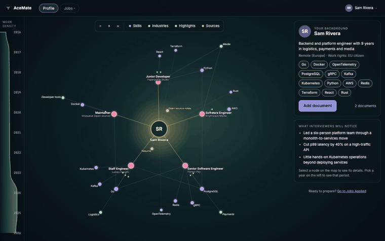
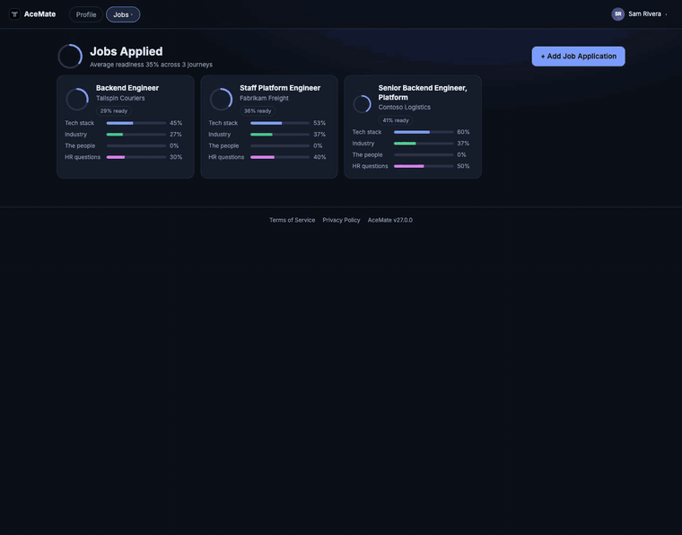
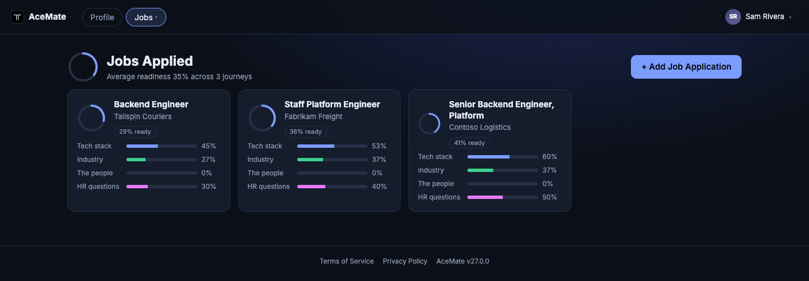
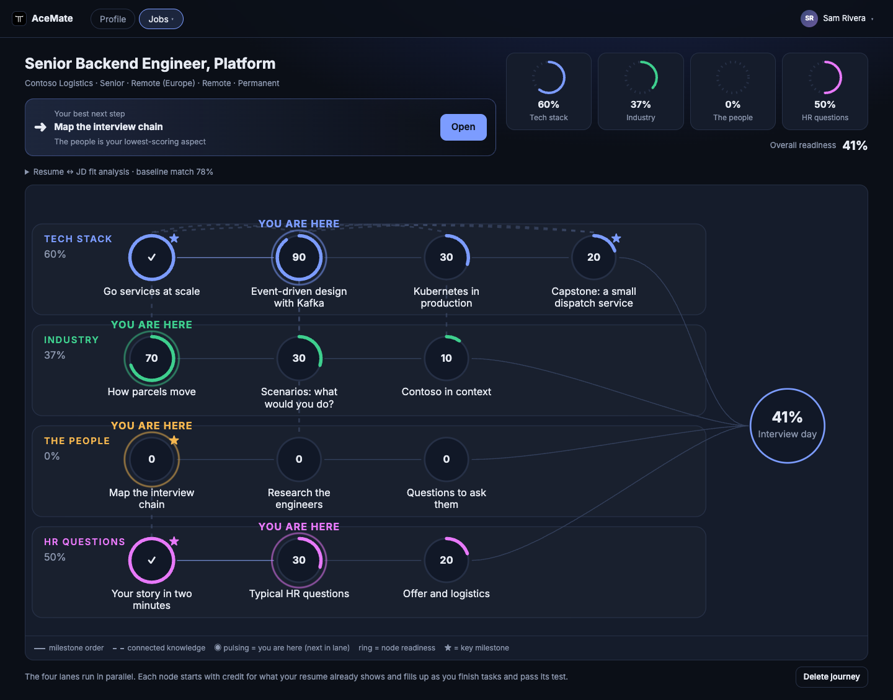
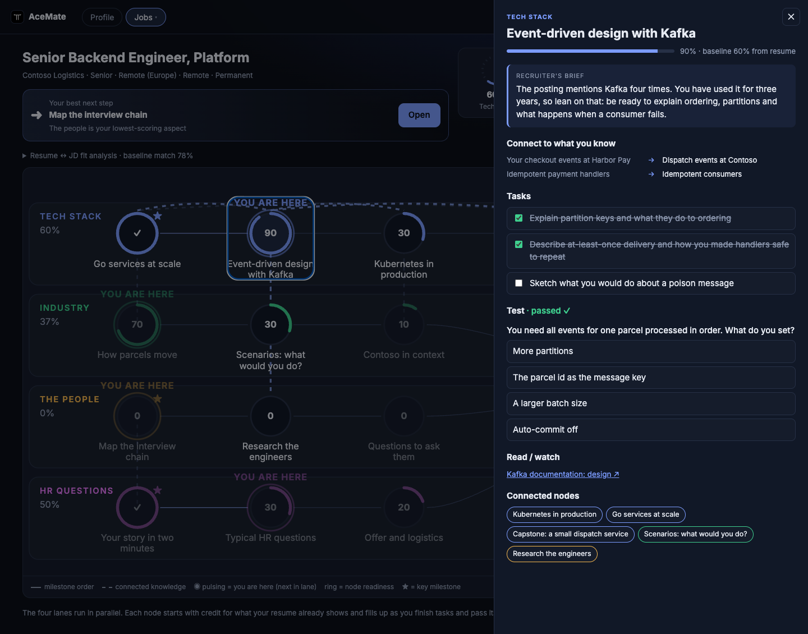
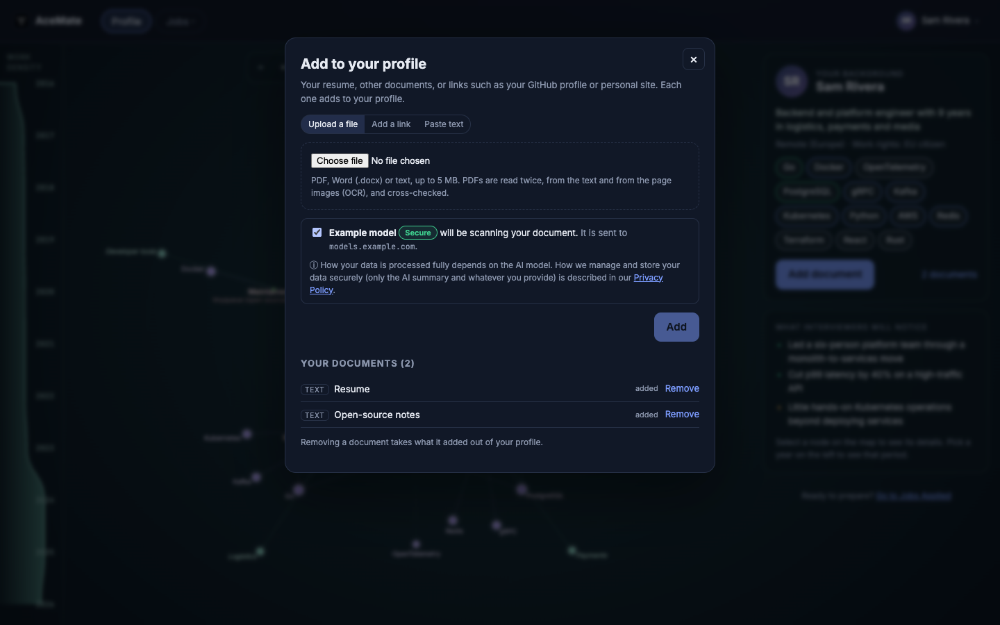
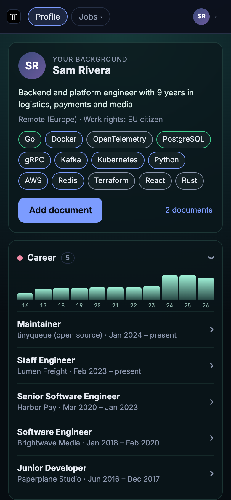

<p align="center"></p>

# AceMate

[](https://github.com/andriantam/ace-mate/actions/workflows/ci.yml)
[](https://github.com/andriantam/ace-mate/stargazers)
[](LICENSE)
[](go.mod)
[](https://github.com/andriantam/ace-mate/commits/main)
[](CONTRIBUTING.md)
[](CODE_OF_CONDUCT.md)


Interview preparation for software engineers. Add your resume and the jobs you're applying for, and an AI model builds a personal **journey** for each application: what to learn about the job's tech stack (explained in terms of the stacks you already know), the industry, the people you'll meet, and the HR questions you'll be asked. A readiness score moves as you work through it.

- **Your profile as a map.** Every document you add (resume, Word file, notes, GitHub profile, personal site) adds to a living graph of your roles, skills, industries and sources, with a timeline of your career.
- **One journey per job.** Four lanes run in parallel: tech stack, industry, the people, and HR questions. Each milestone has a recruiter-style brief, tasks, a quiz or scenario, reading, and a capstone project.
- **Bring your own model.** Claude, or any OpenAI-compatible API (OpenAI, OpenRouter, Ollama, DeepSeek, Groq, vLLM). Use one model for everything, or a different model for reading documents and for writing journeys.
- **Private by default.** Sign in with Google or Okta. Each user's data is isolated by Postgres row-level security. Uploaded files are deleted as soon as they have been read.

## See it



*The profile map floats while idle. Move over a node and it comes forward while its neighbours make room. Click one for details, or pick a year on the timeline.*



| Jobs applied | A journey |
|---|---|
|  |  |
| **A milestone** | **Add a document** |
|  |  |

<p align="center"></p>

*All data in these images is made up: Sam Rivera, the employers and the job postings are fictional.*

## Tech stack

| Part | Built with |
|---|---|
| Server | Go: one static binary serving the JSON API, the background workers and the UI |
| UI | React, TypeScript and Vite, embedded into the binary. ESLint and Vitest. |
| Database | PostgreSQL (pgx) with row-level security. An embedded Postgres runs automatically in development. |
| Background work | A task queue in Postgres with leases and automatic retries |
| Sign-in | Google and Okta through OpenID Connect (PKCE) |
| AI | Anthropic Go SDK, or any OpenAI-compatible chat API |
| Documents | PDF text extraction, page rendering for OCR (PDFium compiled to WebAssembly, no cgo), Word `.docx`, GitHub API for GitHub links |

The frontend, backend and database schema live in one repository and ship as one binary. That's deliberate: there is one thing to build, version and deploy. Postgres itself always runs as its own service in production.

## Install and set up

You need **Go 1.26+** and **Node 22+** (Node only builds the UI).

```bash
git clone https://github.com/<you>/ace-mate.git
cd ace-mate
cp .env.example .env.local
make web     # build the UI into web/dist
make dev     # start the server on http://localhost:3000
```

The first start downloads an embedded Postgres (about 50 MB) into `./.data`. Everything is configured in `.env.local`, and [`.env.example`](.env.example) documents every option.

### Run with Docker

Prefer containers? Compose runs AceMate and its own Postgres together, so you need nothing else installed.

```bash
cp .env.example .env     # then edit .env: your sign-in and AI model settings, and
                         # BASE_URL=http://localhost:8080
docker compose up --build
```

Open http://localhost:8080.

- **`BASE_URL` must be `http://localhost:8080`.** Compose serves port 8080, and the server rejects requests from any other address. Register `http://localhost:8080/api/auth/callback/google` as the redirect URI.
- **Your keys stay out of the image.** `.env` is read by compose at start-up. It is not copied into the image, and git ignores it.
- **Your data lives in the `pgdata` volume.** `docker compose down` keeps it. `docker compose down -v` deletes it.
- **Leave `DATABASE_URL` empty in `.env`.** Compose points the app at its own database.

### 1. Sign-in

Set up at least one provider. Each sign-in button appears only when its settings are present.

- **Google:** Google Cloud Console → Google Auth Platform → Clients → *Create client* (Web application). Add the redirect URI `{BASE_URL}/api/auth/callback/google`, then set `AUTH_GOOGLE_ID` and `AUTH_GOOGLE_SECRET`. While the app is in *Testing*, only the test users you add under *Audience* can sign in.
- **Okta:** Admin → Applications → *Create App Integration* → OIDC → Web Application. Add the redirect URI `{BASE_URL}/api/auth/callback/okta`, then set `AUTH_OKTA_ID`, `AUTH_OKTA_SECRET` and `AUTH_OKTA_ISSUER` (for example `https://your-org.okta.com`).

For local development without OAuth, set `DEV_LOGIN=true` and open `http://localhost:3000/api/auth/dev`. The server refuses this setting unless `BASE_URL` is localhost.

### 2. AI model

Set one default model. Without one the app still runs, but adding documents and building journeys are disabled.

**Claude:**

```bash
ANTHROPIC_API_KEY=sk-ant-...
LLM_MODEL=claude-haiku-5-5      # or claude-sonnet-5-5 / claude-opus-5-5
```

**Any OpenAI-compatible API:**

```bash
LLM_PROVIDER=openai
LLM_BASE_URL=https://openrouter.ai/api/v1
LLM_MODEL=<model id from your provider>
LLM_API_KEY=<key>
LLM_STRUCTURED=json_schema      # use json_object if the model rejects json_schema
LLM_VISION=true                 # only if the model reads images
```

| Where it runs | `LLM_BASE_URL` | `LLM_STRUCTURED` |
|---|---|---|
| OpenAI | `https://api.openai.com/v1` | `json_schema` |
| OpenRouter | `https://openrouter.ai/api/v1` | `json_schema` or `json_object` |
| Ollama (local) | `http://localhost:11434/v1` | `json_schema` |
| DeepSeek | `https://api.deepseek.com` | `json_object` |
| Groq | `https://api.groq.com/openai/v1` | `json_schema` |
| vLLM, LM Studio, llama.cpp | their `/v1` URL | start with `json_schema` |

**A different model per tool (optional).** Add a prefix to any `LLM_*` setting to override it for one tool. Anything you don't set is inherited from the default, and a different provider or host never receives the default's API key.

| Tool | Prefix | Example |
|---|---|---|
| Document reader (resumes, documents, links) | `DOCS_` | `DOCS_LLM_MODEL=…` with `DOCS_LLM_VISION=true` for OCR |
| Job analysis and journeys | `JOURNEY_` | `JOURNEY_LLM_PROVIDER=anthropic`, `JOURNEY_LLM_MODEL=claude-sonnet-5-5` |

Tips:
- **Reasoning models** spend output tokens on hidden thinking. Raise `LLM_MAX_TOKENS` (for example `32000`) or journeys may be cut short.
- **`LLM_PRIVACY`** sets the Secure / Not secure label users see before sending anything. Only set `secure` after reading your provider's data terms.
- **A journey is about ten model calls.** `LLM_CONCURRENCY` runs them in parallel, and `LLM_BATCH_SIZE` writes more milestones per call.

### 3. Legal details

The Terms of Service and Privacy Policy describe AceMate as it ships and are filled in from `LEGAL_OPERATOR`, `LEGAL_CONTACT_EMAIL`, `LEGAL_HOSTING` and `LEGAL_JURISDICTION`.

> **Before you open your site to the public**, review both documents (`web/src/pages/legal`) for your jurisdiction and for how you run the app, ideally with a lawyer. Update them whenever you change what is collected or who processes it, and bump `Version` in `internal/legal`. Every user is then asked to accept again. [docs/legal-checklist.md](docs/legal-checklist.md) lists the risks to check.

### Development

| Command | What it does |
|---|---|
| `make dev` | Run the server (embedded Postgres, `.env.local`) |
| `make web` | Build the UI into `web/dist` |
| `make build` | Build a single binary at `bin/server` |
| `make test` | `go vet`, all Go tests, then UI lint, typecheck and tests |
| `make lint` | gofmt check and ESLint |
| `make docker` | Build the container image |

For UI hot reload, run `make dev` in one terminal and `cd web && npm run dev` in another, then open `http://localhost:5173`.

## Deploy

AceMate is one binary that needs Postgres. Use a container host or a VM, not serverless functions: the server runs background workers.

```bash
docker build --build-arg VERSION=27.0.1 -t acemate .
docker run -p 8080:8080 --env-file prod.env acemate
```

Or run `make build` and start `bin/server`. In production, set:

1. `APP_ENV=production` and an https `BASE_URL`, for example `https://prep.example.com`.
2. `DATABASE_URL` for a managed Postgres (Neon, Supabase, RDS, …). The schema is applied on startup.
3. `LEGAL_CONTACT_EMAIL` (required) and the other `LEGAL_*` settings, after reviewing the legal pages.
4. The sign-in redirect URI `{BASE_URL}/api/auth/callback/<provider>` at Google or Okta.
5. `TRUST_PROXY=true` when running behind a load balancer, reverse proxy or tunnel.
6. A spending limit with your AI provider, and `GENERATION_DAILY_LIMIT` for each user.

**Health checks.** `GET /healthz` reports that the process is up (use it for liveness). `GET /readyz` also checks the database (use it for readiness and load balancers). The container image checks itself with `/server healthcheck`.

**Background work.** Reading documents and writing journeys run as tasks in a Postgres queue, so you can run several instances. A worker holds a lease on a task and renews it while it works. If an instance stops, its tasks are picked up again once the lease runs out (about two minutes), and a clean shutdown hands them back at once. When the AI service is busy or unreachable, a task is tried up to three times, waiting 20 s and then 40 s between attempts. A journey keeps the parts already written and continues from there.

To run a server you host yourself on your own domain, a Cloudflare Tunnel (`cloudflared`) works well: point a subdomain at `http://localhost:<PORT>` and set `BASE_URL` to that subdomain.

## Pages

**Sign in.** Continue with Google or Okta. The first time, you're asked to accept the Terms of Service and Privacy Policy. Marketing emails are a separate, optional choice.

**Profile.** A map of you: your photo in the centre, your roles on the first ring, the skills each role used and the industries you worked in further out, and the documents everything came from. The map drifts gently while you read it. Move the mouse over it and the nearest node comes forward while the rest make room, with outer rings moving more than inner ones. Click a node to see its details, drag to pan, scroll to zoom, and toggle layers from the toolbar. The timeline on the left shows how much work each year held: pick a year to highlight that period. On phones the map becomes an expandable list. With *reduce motion* turned on in your system settings, the map stays still.
- **Add document** opens a window where you upload a file (PDF, Word `.docx`, `.txt`, `.md`), add a link (a GitHub profile or repository, or any public page) or paste text. You tick which AI model will read it, with its Secure / Not secure label, before anything is sent. PDFs are read twice, from the text and from images of the pages, and the two readings are cross-checked. Progress is shown live, and processing continues if you close the window.
- **Your background** lists your headline, location, work rights and skills. Removing a document removes what it added.

**Jobs › Jobs Applied.** Every application with its readiness score and the score for each lane.

**Jobs › Add Job Application.** Paste a job link, or the job description if the site blocks reading, plus anything you know: the team, the people, the level, what the recruiter said. The page shows which AI model will build the journey.

**Journey.** The map of one application: four lanes of milestones, with your best next step highlighted. Open a milestone to read the brief, tick off tasks, take the quiz or scenario, and write notes about the people you'll meet. Each milestone starts with credit for what your profile already shows. While a journey is being written, finished parts appear as soon as they're ready, so you can start straight away. Anything that couldn't be written can be retried on its own.

**Your data** (from the menu under your name). Change your marketing choice, export everything as JSON, or delete your account and all of its data.

## Limitations

- **AI output can be wrong.** Journeys are only as good as the model behind them. Facts marked "verify" need checking, and free or small models give noticeably weaker results.
- **Free models are slow and not private.** A journey takes 2 to 5 minutes on a free reasoning model, and free tiers may log or train on what you send. Use a paid model with suitable data terms for real users.
- **Some job sites block reading.** LinkedIn, Workday and similar sites often refuse automated requests. Paste the job description instead.
- **Rate limits are per instance.** Sign-in and upload rate limits are kept in memory, so with several instances each one limits on its own. The daily journey limit is stored in the database and applies across instances.
- **Scanned documents need a vision model.** Without `LLM_VISION=true`, a PDF with no text layer can't be read.
- **Only Google and Okta sign-in.** Other OpenID Connect providers need a small code change in `internal/auth`.
- **English only.** Prompts and the UI are written in English.
- **No email sending.** The marketing opt-in is recorded with its date, but AceMate doesn't send email. Export the list from the database if you use it.

## Versioning

AceMate uses calendar versioning ([CalVer](https://calver.org)) in the form `YEAR.MAJOR.MINOR`, for example `27.0.0`.

| Part | Meaning |
|---|---|
| `YEAR` | The year of the release, in two digits. It changes with the first release of a new year. |
| `MAJOR` | A change that needs something from you when you upgrade: a renamed or removed setting, a database change that can't run on its own, or a changed API. It starts at 0 each year. |
| `MINOR` | Everything else: features, fixes and dependency updates. Upgrading is safe. |

So `27.0.0` → `27.0.1` is a safe upgrade, `27.0.1` → `27.1.0` means read the changelog first, and the first release of the next year starts again at `28.0.0`. Releases are listed in [CHANGELOG.md](CHANGELOG.md), and the running version is shown in the page footer and at `/healthz`.

## License

[MIT](LICENSE). See [SECURITY.md](SECURITY.md) to report a vulnerability, and [CONTRIBUTING.md](CONTRIBUTING.md) to contribute. Everyone taking part is expected to follow the [Code of Conduct](CODE_OF_CONDUCT.md).
